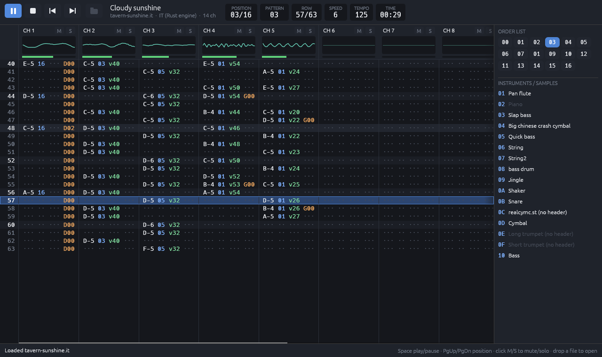

# modplay-rs

トラッカー音楽（MOD・IT・S3M・XM）を鳴らす、Rust だけで書いた再生エンジンとプレイヤーです。

**▶ ブラウザで試す：https://mooyax.github.io/modplay-rs/** （曲ファイルをページにドロップして、クリックすると鳴ります）

- **MOD**：[pt2-clone](https://github.com/8bitbubsy/pt2-clone)（8bitbubsy 氏による ProTracker 2 クローン）の再生部分の移植。元版と同じ音を出します。
- **XM**：[ft2-clone](https://github.com/8bitbubsy/ft2-clone)（同じく 8bitbubsy 氏による FastTracker 2 クローン）の再生ルーチンの移植。
- **IT・S3M**：自作のエンジン。libopenmpt と同じ曲を鳴らして比べ、再生位置と音量が合うように作っています。
- **modplay**：トラッカー風の画面で曲を再生する GUI プレイヤー（Windows / Linux / macOS）。
- **web/**：同じプレイヤーのブラウザ版（WebAssembly）。インストールなしで、ブラウザに曲をドロップして聴けます（[公開版](https://mooyax.github.io/modplay-rs/)）。
- **mobile/**：libopenmpt と同じ C の関数名を持つ静的ライブラリ（iOS・Android 向け）。libopenmpt を使っているアプリの差し替え用です。

C/C++ のライブラリには依存しません（比較ツールだけ、任意で libopenmpt を使います）。



## ProTracker エンジン（MOD）

| 元のCファイル | Rust | 内容 |
|---|---|---|
| `pt2_paula.c` | `src/paula.rs` | Paula（Amigaの音源チップ）エミュレーション、BLEP合成 |
| `pt2_blep.c` / `pt2_rcfilters.c` / `pt2_downsample2x.c` | `src/dsp.rs` | minBLEP、A500/A1200 の RC フィルタ・LEDフィルタ、2倍ダウンサンプラ |
| `pt2_replayer.c` | `src/replayer.rs` | ProTracker 2.3D リプレイヤ（全エフェクト、PTのバグ挙動も含む） |
| `pt2_audio.c`（出力部） | `src/engine.rs` | ミキサ、ステレオ幅、ディザ、BPM→tick長テーブル |
| `pt2_module_loader.c` / `pt2_load_mod31.c` / `pt2_load_mod15.c` | `src/module.rs` | MOD 読み込み（31/15サンプル、NT/HMNT/FLT/STK 変換を含む） |
| `pt2_mod2wav.c` | `src/mod2wav.rs` | MOD → WAV 書き出し（ループ回数、フェードアウト） |
| `pt2_tables.c` | `src/tables.rs` | 周期表・ビブラートテーブル・BLEPテーブル（Cソースから自動生成） |

再生エンジン（ライブラリ）と `pt2wav` は外部クレートに依存していません。GUI の `modplay` は `eframe`（egui。ウィンドウと画面）、`cpal`（音声出力）、`rfd`（ファイル選択、Windowsのみ）を使います。

### 使い方

```
cargo build --release
target\release\pt2wav.exe song.mod                 # song.wav を出力
target\release\pt2wav.exe song.mod out.wav --model a500 --stereo 100 --loops 1 --fadeout 6
target\release\pt2wav.exe --help
```

ライブラリとして使う場合：

```rust
let data = std::fs::read("song.mod")?;
let song = modplay::Module::load(&data, modplay::module::DEFAULT_MAX_SAMPLE_LENGTH)?;
let mut engine = modplay::Engine::new(song, modplay::EngineConfig::default());

// リアルタイム再生（オーディオコールバックから呼ぶ）
engine.play_song();
let mut buf = vec![0i16; 1024 * 2]; // ステレオ交互
engine.render(&mut buf);
```

### 元のC版との一致検証

`tools/` に検証用の道具が入っています。

- `tools/cref/` … 元の pt2-clone の C ソース（エンジン部分）をそのままビルドする、画面なしのリファレンス版 MOD2WAV（Linux / WSL 用。SDL2 の開発ヘッダが必要）
- `tools/compare.sh` … C 版と Rust 版で同じ MOD を書き出し、WAV をバイト単位で比較
- `tools/genfuzz.py` … 全エフェクトをランダムに使う MOD を自動生成（ファジング）

検証結果（2026-11-23 時点）：

- libxmp のテスト用 MOD 42 曲：**全曲バイト単位で一致**（A1200/A500、ステレオ幅 0/20/100%、ループ・フェードアウトの各設定で確認）
  - 末尾が欠けた（途中で切れた）MOD ファイルが 3 つあり、C 版はファイルの終わりを越えて読む未定義動作になるため、そのままでは一致しません。Rust 版は欠けた部分を無音（0）として扱います。足りない分を 0 で埋めたファイルでは 3 曲とも完全に一致しました。
- ランダム生成 MOD 300 曲（A1200・ステレオ幅 20%）：**全曲バイト単位で一致**
- ランダム生成 MOD 200 曲（A500・ステレオ幅 100%）：**全曲バイト単位で一致**

```
# WSL 等で
git clone https://github.com/8bitbubsy/pt2-clone
tools/cref/build.sh ./pt2-clone
ls *.mod | tools/compare.sh      # （compare.sh 内のパスは環境に合わせて変更）
```

注意：曲によっては終わりが来ないもの（E6x パターンループの組み合わせ等）があり、元の pt2-clone はそうした曲を延々と書き出し続けます。`pt2wav` は安全のため既定で 30 分（`--max-seconds 1800`）で打ち切ります。`--max-seconds 0` で無制限になります。

```
```

## modplay：トラッカー風プレイヤー（GUI）

トラッカー風の画面で曲を再生します（egui 製）。音はすべて Rust 製のエンジンで作り、C/C++ のライブラリは使いません。

- **MOD**（4チャンネルのProTracker形式）：ProTracker エンジン（pt2-clone の移植。元版と同じ音）
- **IT・S3M**：自作の Rust 製エンジン（`src/it/`）
- **XM**：自作の Rust 製エンジン（`src/xm/`。ft2-clone の再生ルーチンの移植）

画面の構成：

- 上部：再生 / 一時停止・停止・前後のポジション・ファイルを開く、曲名、POSITION / PATTERN / ROW / SPEED / TEMPO / TIME
- チャンネルの見出し：チャンネルごとのスコープ（実際の波形）、VU メーター、M（ミュート）、S（ソロ）
- パターン：全チャンネルを表示し、再生中の行が常に中央に来るようにスクロールします。列は `音名 楽器 音量列 エフェクト`。チャンネルが多いときは横スクロールします。
- 右側：オーダーリスト（クリックでその位置へ移動）と楽器 / サンプルの一覧
- ファイルはウィンドウにドラッグ＆ドロップしても開けます。

```
cargo build --release
target\release\modplay.exe                 # ファイル選択ダイアログが開く
target\release\modplay.exe song.it
```

| 操作 | 内容 |
|---|---|
| Space | 再生 / 一時停止 |
| PageUp / PageDown（または - / +） | 前 / 次のポジションへ |
| O | ファイルを開く |
| Esc | 終了 |
| M / S ボタン | チャンネルのミュート / ソロ |

オプション：`--size 1600x900`（ウィンドウの大きさ）、`--stereo 0〜100`（ステレオの広がり。既定 20）、`--screenshot out.png --at 秒`（画面を PNG に保存して終了）。

### ブラウザ版（`web/`）

同じエンジンと画面を WebAssembly にして、ブラウザで動かします。曲はページにドラッグ＆ドロップするか、フォルダのボタンで開きます。ブラウザの決まりで、音は最初にクリック（かキー入力）したときに出始めます。

```
powershell -ExecutionPolicy Bypass -File web\build-web.ps1 -Serve
```

`web\dist` にページ一式（`index.html`・`.js`・`.wasm`）ができ、`-Serve` を付けると http://localhost:8000/ で開きます（Python が必要）。WebAssembly はファイルを直接開く（file://）と動かないので、Web サーバー経由で開いてください。

- `?url=曲のURL` を付けると、その曲を読み込んだ状態で開きます（曲を置いたサーバーが CORS を許可している必要があります）。
- リポジトリが公開されていれば、`.github/workflows/web.yml` が push のたびにブラウザ版をビルドして GitHub Pages に置きます（Settings → Pages → Source を「GitHub Actions」にしてください）。

### 比較ツールを使う場合だけ：libopenmpt の準備

`examples/` の比較ツール（itcmp・xmcmp・bench の mpt モード）は、libopenmpt と同じ曲を鳴らして答え合わせをします。これらは `--features openmpt` を付けたときだけビルドされ、そのときだけ libopenmpt が必要です。プレイヤーとエンジンには不要です。

- Windows：https://lib.openmpt.org/libopenmpt/download/ から Windows 10 / amd64 の **libopenmpt**（development 用パッケージ）の zip を落とし、プロジェクト直下の `libopenmpt` フォルダに展開します。`.lib` と `.dll` はビルド時に自動で探し、DLL は `target\release` にコピーされます。別の場所に置く場合は環境変数 `LIBOPENMPT_DIR` で指定します。
- Linux / macOS：パッケージマネージャで libopenmpt を入れます（pkg-config で探します）。

```
cargo run --release --features openmpt --example itcmp -- song.it 60
```

## Rust 製 IT エンジン（`src/it/`）

- `s3m.rs`：S3M の読み込み。IT と同じ内部形式に変換し、ST3 特有の挙動（ピリオドベースの音程、共有エフェクトメモリ、速いボリュームスライド、ループの優先順位など）は再生側で切り替えます
- `format.rs`：IT の読み込み（新旧の楽器形式、IT2.14/2.15 圧縮サンプル、ステレオサンプル、パックされたパターン）
- `player.rs`：再生（A〜Z のエフェクト、音量列、エンベロープとキャリー、フェードアウト、NNA/DCT/DCA、パターンループ、オートビブラート、レゾナンスフィルタなど）
  - レゾナンスフィルタ：楽器の初期カットオフ／レゾナンス、Zxx（MIDI マクロ。ファイルに埋め込まれた設定または既定値。SFx で切り替え）、フィルタエンベロープ。係数は OpenMPT の IT 互換モードと同じ式です。
- `examples/itcmp.rs`：libopenmpt と同じ曲を並べて鳴らし、再生位置・音量の一致を比べる検証ツール

```
cargo run --release --features openmpt --example itcmp -- song.it 60          # 60秒ぶん比較
cargo run --release --features openmpt --example itcmp -- song.it 60 --solo 3 # チャンネル3だけ比較
```

libxmp のテスト用 IT 114 ファイルで、107 ファイルは再生位置（オーダー・行）が libopenmpt と完全一致します。実曲（Fight2.it、4th_Symmetriad.it など）は音量もほぼ一致し、フィルタを多用する 4th_Symmetriad.it も周波数帯ごとの音量差が ±0.5dB 以内です。

## Rust 製 XM エンジン（`src/xm/`）

8bitbubsy の [ft2-clone](https://github.com/8bitbubsy/ft2-clone)（FastTracker II の再生ルーチンを忠実に再現したもの）から、再生ロジックを Rust に移植しました。

- `format.rs`：XM の読み込み（v1.02〜1.04、デルタ圧縮サンプル、ModPlug ADPCM、ステレオサンプルのモノラル化、FT2 と同じ値の補正）
- `player.rs`：再生（tickReplayer / getNewNote / 全エフェクト / 音量列 / エンベロープ / フェードアウト / オートビブラート）。16 ビットの周期計算の癖などの FT2 の挙動もそのまま移しています。ミキサーは自前（線形補間・ボリュームランプ）で、出力レベルとパン法則は libopenmpt に合わせています（FT2 製の曲は FT2 の平方根パン）
- `tables.rs`：ft2-clone の周期表・ビブラート表など
- `examples/xmcmp.rs`：libopenmpt との比較ツール（使い方は itcmp と同じ）

MilkyTracker 付属の実曲 5 曲で、再生位置は完全一致、音量比 0.99〜1.01 です。FT2 の細かい挙動のテスト曲で libopenmpt と結果が違う場合は、ft2-clone（実機 FT2）の挙動を正としています。OpenMPT 独自の拡張（ステレオサンプル、逆再生など）には対応していません。

## 未対応のもの

- PowerPacker（PP20）・XPK で圧縮された MOD の展開（`pt2_pp_unpack.c` / `pt2_xpk_unpack.c`）
- IT エンジン：外部 MIDI 出力や VST 用の MIDI マクロ、OpenMPT 独自の拡張（スムーズ MIDI マクロ `\xx` など）
- XM エンジン：OpenMPT 独自の拡張（ステレオサンプル、逆再生など）
- 補間は線形のみ（libopenmpt の既定は 8 タップの sinc）

## 謝辞

このプロジェクトは、次の作品と人々の仕事の上に成り立っています。

- **[pt2-clone](https://github.com/8bitbubsy/pt2-clone)**（Olav Sørensen 氏 / 8bitbubsy）— MOD エンジンは、その再生部分・Paula エミュレーション・フィルタの移植です。
- **[ft2-clone](https://github.com/8bitbubsy/ft2-clone)**（同じく Olav Sørensen 氏）— XM エンジンは、その再生ルーチンの移植です。
- **[OpenMPT / libopenmpt](https://openmpt.org/)**（OpenMPT Project Developers、Olivier Lapicque 氏）— IT・S3M エンジンは libopenmpt の動きを答え合わせの基準にして作りました。レゾナンスフィルタの係数や、古い ModPlug 製の曲の音量の表などは OpenMPT のソースに合わせています。
- **[libxmp](https://github.com/libxmp/libxmp)** — そのテスト用の曲で、エンジンの動きを確かめました（リポジトリには含めていません）。
- そして元のトラッカーたち：Ultimate Soundtracker と ProTracker（Amiga）、Scream Tracker 3（Future Crew）、FastTracker 2（Triton）、Impulse Tracker（Jeffrey Lim 氏）。それらで曲を作ってきたすべての人に感謝します。

プレイヤーの「About」ボタンからも、同じ内容を見られます。

## ライセンス

BSD 3-Clause です（`LICENSE` を参照）。ProTracker エンジンは pt2-clone、XM エンジンは ft2-clone（どちらも Olav Sørensen 氏、BSD 3-Clause）の派生物です。IT・S3M エンジンは OpenMPT（BSD 3-Clause）の式や表を使っています。それぞれの著作権表示を `LICENSE` に載せています。
